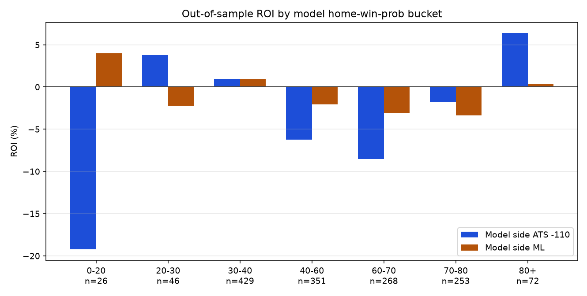
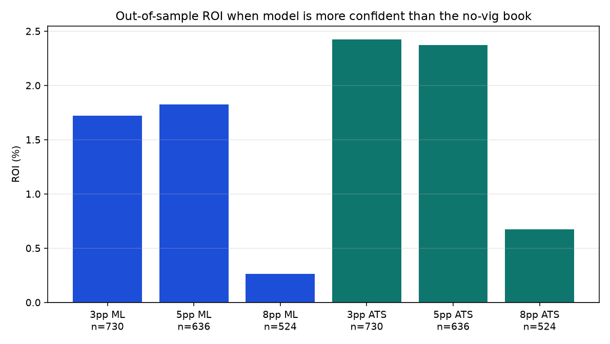

# NFL v2 bucket strategy backtest

**Generated:** 2026-10-19T20:38:55.920577+00:00
**Live model (2026 only):** `nfl-v2-live-20260906` — not modified
**Walk-forward candidate:** `hgb_small` + `ridge_a50` + `isotonic`
**Rules tested:** 75

This is analysis, not a serving change and not a betting product. Missing prices stay unscored. In-sample numbers are labeled and are **not** an edge.

## Headline

**Q1:** In the 40–60 toss-up band (OOS n=351), backing the book underdog is still not a licensed strategy. Dog ML 136-217-1 / -4.1% (CI -17.8% to 9.1%). Model-side ML 187-163-1 / -2.0%. Book-favorite ML 217-136-1 / -4.1%. Dog ATS -110 182-166-9 / -0.2%. None of these CIs both exclude 0 and survive the season + Bonferroni bar.

**Q2:** Confident buckets are not a usable betting surface. Book-favorite ML when the model is >60% home: 420-170-1 / -2.4% (CI -7.4% to 3.1%). When the model is <40% home: 319-179-3 / -3.8%. Model-minus-book ≥5pp ML: 340-294-2 / 1.8% (CI -5.6% to 9.9%). The raw confident buckets and the disagreement filter both fail the strategy bar. That matches the health-check diagnosis: the model is overconfident, not quietly +EV at short prices.

Highest-ROI OOS rule: **80+: back model on ATS at actual/close price** — n=72, 39-31-2, ROI 9.0%, 95% CI -13.9% to 31.8%, Bonferroni p=1.000. This does **not** qualify as a strategy: the bar is OOS + same-sign ROI in ≥3 seasons with n≥20 + 95% CI excluding 0 + Bonferroni-adjusted p<0.05.

Largest-n near-edge (n≥200): **Model-side edge vs no-vig book ≥ 5pp: back model side on ATS at actual/close price** — n=636, 333-288-15, ROI 3.6%, 95% CI -4.2% to 11.3%. Still includes 0.

## Sample

| Slice | Kind | n | Seasons |
| --- | --- | ---: | --- |
| Walk-forward 2021–2025 (train on prior seasons only) | **out-of-sample** | 1359 | 2021, 2022, 2023, 2024, 2025 |
| Frozen `nfl-v2-live-20260906` on 2026 REG | **out-of-sample** | 92 | 2026 weeks 1–6 |
| Pooled OOS used for all headline tables | **out-of-sample** | 1451 | 2021–2026 |
| Frozen artifact on 2025 REG | **in-sample** (trained_through=2025) | 272 | 2025 |

2026 n≈92 is real OOS for the frozen artifact but too small to license a rule by itself. 2021 uses a single prior season, so isotonic OOF calibration is impossible; that year is raw HGB. 2022–2025 use the production OOF-isotonic recipe. 2025 reconstructed through the frozen live artifact is in-sample and is appendix-only.

PR #41 health overlap on 2026: joined=92, max |Δp|=0.000000.

### Bucket occupancy (OOS)

| Season | n | Unique p | Calibrator | 0-20 | 20-30 | 30-40 | 40-60 | 60-70 | 70-80 | 80+ |
| ---: | ---: | ---: | --- | ---: | ---: | ---: | ---: | ---: | ---: | ---: |
| 2021 | 272 | 272 | single_prior_season_no_oof | 26 | 46 | 33 | 71 | 23 | 35 | 38 |
| 2022 | 271 | 15 | oof_seasons | 0 | 0 | 159 | 0 | 74 | 24 | 14 |
| 2023 | 272 | 22 | oof_seasons | 0 | 0 | 79 | 83 | 27 | 79 | 4 |
| 2024 | 272 | 14 | oof_seasons | 0 | 0 | 73 | 82 | 56 | 54 | 7 |
| 2025 | 272 | 21 | oof_seasons | 0 | 0 | 64 | 83 | 75 | 41 | 9 |
| 2026 | 92 | 17 | frozen_live_artifact | 0 | 0 | 21 | 38 | 13 | 20 | 0 |

2022 walk-forward isotonic **never emitted a probability in 40–60** (0 of 271 games). Q1 therefore has no 2022 season. The same coarseness shows up live: PR #41 counted 17 unique 2026 probabilities. 2021 tails (0–20 / 20–30) exist only because that year could not fit OOF isotonic.

## Prices and vig

- Close: nflverse `spread_line`, `home_spread_odds`, `away_spread_odds`, `home_moneyline`, `away_moneyline`.
- Home spread = `-spread_line` (home favorite negative), same convention as the health check.
- Book win probability = no-vig split of the two moneylines (`no_vig_home_probability`).
- ATS `-110` always stakes at -110. ATS actual uses the nflverse close price and falls back to -110 only when that side's price is missing.
- Moneyline uses the actual close. Ties push. Fail closed if a required price is missing.

Line shopping (±1.5 across books) is not measurable from these files. nflverse exposes one PFR/consensus close (`spread_line`, `home_spread_odds`, `away_spread_odds`, moneylines), not a book panel. Serving toss-up copy in #42 mentions books disagreeing at ±1.5; that is a live-book observation, not a historical series in this backtest.

Spread-price coverage: 100.0%. Moneyline coverage: 100.0%. Multi-book rows: 0.

## Multiple comparisons

75 rules were tested on the same OOS pool (toss-up sides × markets, confident buckets × model/book-favorite × markets, and model-minus-book thresholds 3/5/8pp). A 95% CI that excludes 0 is not enough. Bonferroni uses `75` tests. A rule is called a **strategy** only if it is out-of-sample, the CI excludes 0, Bonferroni-adjusted p < 0.05, and ROI keeps the same sign in at least three seasons with n≥20.

## Q1 — toss-up band (model home or away win prob 40–60%)

Serving still withholds a moneyline pick in the narrower ±5pp band from #42. This table is the owner's 40–60 analysis band, not a serving change.

| Rule | Sample | n | W-L-P | ROI | Units | Bootstrap 95% CI | Strategy? |
| --- | --- | ---: | --- | ---: | ---: | --- | --- |
| Toss-up 40-60: back model on ATS at -110 | out_of_sample | 351 | 169-175-7 | -6.2% | -21.36 | -16.8% to 3.2% | False |
| Toss-up 40-60: back model on ATS at actual/close price | out_of_sample | 351 | 169-175-7 | -5.6% | -19.22 | -16.0% to 4.1% | False |
| Toss-up 40-60: back model on moneyline at actual/close price | out_of_sample | 351 | 187-163-1 | -2.0% | -7.16 | -12.0% to 8.5% | False |
| Toss-up 40-60: back book dog on ATS at -110 | out_of_sample | 357 | 182-166-9 | -0.2% | -0.55 | -10.0% to 9.7% | False |
| Toss-up 40-60: back book dog on ATS at actual/close price | out_of_sample | 357 | 182-166-9 | 0.5% | 1.80 | -9.5% to 10.5% | False |
| Toss-up 40-60: back book dog on moneyline at actual/close price | out_of_sample | 354 | 136-217-1 | -4.1% | -14.50 | -17.8% to 9.1% | False |
| Toss-up 40-60: back book fav on ATS at -110 | out_of_sample | 357 | 166-182-9 | -8.9% | -31.09 | -18.8% to 0.9% | False |
| Toss-up 40-60: back book fav on ATS at actual/close price | out_of_sample | 357 | 166-182-9 | -8.5% | -29.42 | -18.3% to 1.5% | False |
| Toss-up 40-60: back book fav on moneyline at actual/close price | out_of_sample | 354 | 217-136-1 | -4.1% | -14.44 | -12.2% to 3.8% | False |

Per-season for the three moneyline sides:

### Toss-up 40-60: back model on moneyline at actual/close price

| Season | n | W-L-P | ROI | Units | 95% CI |
| ---: | ---: | --- | ---: | ---: | --- |
| 2021 | 71 | 40-31-0 | 6.4% | 4.58 | -17.0% to 28.9% |
| 2023 | 82 | 46-36-0 | 4.3% | 3.49 | -17.1% to 25.6% |
| 2024 | 81 | 49-32-0 | 8.5% | 6.92 | -11.8% to 28.2% |
| 2025 | 82 | 37-45-0 | -20.2% | -16.57 | -39.4% to -0.1% |
| 2026 | 35 | 15-19-1 | -16.4% | -5.57 | -48.7% to 16.5% |

### Toss-up 40-60: back book dog on moneyline at actual/close price

| Season | n | W-L-P | ROI | Units | 95% CI |
| ---: | ---: | --- | ---: | ---: | --- |
| 2021 | 71 | 34-37-0 | 20.8% | 14.76 | -8.3% to 51.5% |
| 2023 | 81 | 25-56-0 | -20.9% | -16.90 | -47.0% to 7.4% |
| 2024 | 81 | 26-55-0 | -23.3% | -18.88 | -47.2% to 0.1% |
| 2025 | 83 | 33-50-0 | -0.0% | -0.04 | -27.2% to 28.6% |
| 2026 | 38 | 18-19-1 | 17.7% | 6.56 | -24.3% to 60.0% |

### Toss-up 40-60: back book fav on moneyline at actual/close price

| Season | n | W-L-P | ROI | Units | 95% CI |
| ---: | ---: | --- | ---: | ---: | --- |
| 2021 | 71 | 37-34-0 | -18.9% | -13.44 | -37.0% to -1.3% |
| 2023 | 81 | 56-25-0 | 10.5% | 8.54 | -5.3% to 26.7% |
| 2024 | 81 | 55-26-0 | 4.5% | 3.66 | -10.8% to 20.3% |
| 2025 | 83 | 50-33-0 | -7.6% | -6.35 | -25.8% to 9.8% |
| 2026 | 38 | 19-18-1 | -18.5% | -6.85 | -44.4% to 7.8% |

Model-minus-book inside the toss-up band (does any edge sit in disagreement, not the raw 40–60 bucket?):

| Rule | Sample | n | W-L-P | ROI | Units | Bootstrap 95% CI | Strategy? |
| --- | --- | ---: | --- | ---: | ---: | --- | --- |
| Toss-up 40-60 and model-side edge ≥ 3pp: back model side on ATS at -110 | out_of_sample | 167 | 87-79-1 | 0.1% | 0.09 | -14.9% to 13.9% | False |
| Toss-up 40-60 and model-side edge ≥ 3pp: back model side on ATS at actual/close price | out_of_sample | 167 | 87-79-1 | 0.7% | 1.13 | -14.2% to 14.6% | False |
| Toss-up 40-60 and model-side edge ≥ 3pp: back model side on moneyline at actual/close price | out_of_sample | 167 | 71-95-1 | 0.3% | 0.49 | -17.8% to 18.7% | False |
| Toss-up 40-60 and model-side edge ≥ 5pp: back model side on ATS at -110 | out_of_sample | 148 | 79-68-1 | 2.6% | 3.82 | -14.3% to 18.2% | False |
| Toss-up 40-60 and model-side edge ≥ 5pp: back model side on ATS at actual/close price | out_of_sample | 148 | 79-68-1 | 3.3% | 4.81 | -13.6% to 18.8% | False |
| Toss-up 40-60 and model-side edge ≥ 5pp: back model side on moneyline at actual/close price | out_of_sample | 148 | 63-84-1 | 3.0% | 4.34 | -16.4% to 23.7% | False |
| Toss-up 40-60 and model-side edge ≥ 8pp: back model side on ATS at -110 | out_of_sample | 130 | 64-65-1 | -5.3% | -6.82 | -21.6% to 11.0% | False |
| Toss-up 40-60 and model-side edge ≥ 8pp: back model side on ATS at actual/close price | out_of_sample | 130 | 64-65-1 | -4.7% | -6.02 | -21.2% to 12.0% | False |
| Toss-up 40-60 and model-side edge ≥ 8pp: back model side on moneyline at actual/close price | out_of_sample | 130 | 50-79-1 | -3.1% | -3.95 | -25.0% to 18.8% | False |

## Q2 — confident bands

Under 40 / over 60, then 10-point bins and their mirrors. Back the model side and the book favorite, ATS and ML.

| Rule | Sample | n | W-L-P | ROI | Units | Bootstrap 95% CI | Strategy? |
| --- | --- | ---: | --- | ---: | ---: | --- | --- |
| under 40: back model on ATS at -110 | out_of_sample | 501 | 256-232-13 | 0.1% | 0.73 | -8.5% to 8.4% | False |
| under 40: back model on ATS at actual/close price | out_of_sample | 501 | 256-232-13 | 1.1% | 5.51 | -7.7% to 9.6% | False |
| under 40: back model on moneyline at actual/close price | out_of_sample | 501 | 304-194-3 | 0.8% | 3.78 | -6.6% to 8.4% | False |
| under 40: back book fav on ATS at -110 | out_of_sample | 501 | 235-253-13 | -8.1% | -39.36 | -16.7% to 0.9% | False |
| under 40: back book fav on ATS at actual/close price | out_of_sample | 501 | 235-253-13 | -7.4% | -36.12 | -16.0% to 1.4% | False |
| under 40: back book fav on moneyline at actual/close price | out_of_sample | 501 | 319-179-3 | -3.8% | -18.96 | -10.3% to 2.6% | False |
| over 60: back model on ATS at -110 | out_of_sample | 593 | 290-286-17 | -3.9% | -22.36 | -11.5% to 3.7% | False |
| over 60: back model on ATS at actual/close price | out_of_sample | 593 | 290-286-17 | -2.9% | -16.61 | -10.7% to 4.6% | False |
| over 60: back model on moneyline at actual/close price | out_of_sample | 593 | 412-180-1 | -2.8% | -16.36 | -8.9% to 2.5% | False |
| over 60: back book fav on ATS at -110 | out_of_sample | 593 | 292-284-17 | -3.2% | -18.55 | -11.2% to 4.1% | False |
| over 60: back book fav on ATS at actual/close price | out_of_sample | 593 | 292-284-17 | -2.2% | -12.89 | -10.3% to 5.3% | False |
| over 60: back book fav on moneyline at actual/close price | out_of_sample | 591 | 420-170-1 | -2.4% | -14.06 | -7.4% to 3.1% | False |
| 0-20 (80+ mirror): back model on ATS at -110 | out_of_sample | 26 | 11-15-0 | -19.2% | -5.00 | -55.9% to 17.5% | False |
| 0-20 (80+ mirror): back model on ATS at actual/close price | out_of_sample | 26 | 11-15-0 | -16.9% | -4.40 | -54.7% to 20.8% | False |
| 0-20 (80+ mirror): back model on moneyline at actual/close price | out_of_sample | 26 | 17-9-0 | 4.0% | 1.04 | -29.7% to 38.5% | False |
| 0-20 (80+ mirror): back book fav on ATS at -110 | out_of_sample | 26 | 9-17-0 | -33.9% | -8.82 | -70.6% to 2.8% | False |
| 0-20 (80+ mirror): back book fav on ATS at actual/close price | out_of_sample | 26 | 9-17-0 | -32.2% | -8.36 | -69.6% to 5.6% | False |
| 0-20 (80+ mirror): back book fav on moneyline at actual/close price | out_of_sample | 26 | 14-12-0 | -27.5% | -7.15 | -54.2% to -2.4% | False |
| 20-30 (70-80 mirror): back model on ATS at -110 | out_of_sample | 46 | 25-21-0 | 3.8% | 1.73 | -25.3% to 32.8% | False |
| 20-30 (70-80 mirror): back model on ATS at actual/close price | out_of_sample | 46 | 25-21-0 | 6.8% | 3.12 | -22.5% to 36.4% | False |
| 20-30 (70-80 mirror): back model on moneyline at actual/close price | out_of_sample | 46 | 29-17-0 | -2.2% | -1.03 | -26.8% to 21.6% | False |
| 20-30 (70-80 mirror): back book fav on ATS at -110 | out_of_sample | 46 | 24-22-0 | -0.4% | -0.18 | -29.4% to 28.7% | False |
| 20-30 (70-80 mirror): back book fav on ATS at actual/close price | out_of_sample | 46 | 24-22-0 | 1.6% | 0.74 | -27.7% to 30.3% | False |
| 20-30 (70-80 mirror): back book fav on moneyline at actual/close price | out_of_sample | 46 | 32-14-0 | 2.0% | 0.94 | -18.0% to 20.7% | False |
| 30-40 (60-70 mirror): back model on ATS at -110 | out_of_sample | 429 | 220-196-13 | 1.0% | 4.00 | -8.2% to 10.1% | False |
| 30-40 (60-70 mirror): back model on ATS at actual/close price | out_of_sample | 429 | 220-196-13 | 1.6% | 6.80 | -7.5% to 11.2% | False |
| 30-40 (60-70 mirror): back model on moneyline at actual/close price | out_of_sample | 429 | 258-168-3 | 0.9% | 3.77 | -7.6% to 8.9% | False |
| 30-40 (60-70 mirror): back book fav on ATS at -110 | out_of_sample | 429 | 202-214-13 | -7.3% | -30.36 | -16.0% to 2.3% | False |
| 30-40 (60-70 mirror): back book fav on ATS at actual/close price | out_of_sample | 429 | 202-214-13 | -6.9% | -28.50 | -15.4% to 2.8% | False |
| 30-40 (60-70 mirror): back book fav on moneyline at actual/close price | out_of_sample | 429 | 273-153-3 | -3.0% | -12.74 | -10.1% to 4.1% | False |
| 60-70: back model on ATS at -110 | out_of_sample | 268 | 126-137-5 | -8.5% | -22.45 | -19.4% to 3.1% | False |
| 60-70: back model on ATS at actual/close price | out_of_sample | 268 | 126-137-5 | -7.6% | -19.90 | -18.8% to 4.2% | False |
| 60-70: back model on moneyline at actual/close price | out_of_sample | 268 | 172-96-0 | -3.0% | -8.14 | -12.0% to 6.0% | False |
| 60-70: back book fav on ATS at -110 | out_of_sample | 268 | 131-132-5 | -4.9% | -12.91 | -16.5% to 6.7% | False |
| 60-70: back book fav on ATS at actual/close price | out_of_sample | 268 | 131-132-5 | -4.0% | -10.49 | -15.5% to 7.7% | False |
| 60-70: back book fav on moneyline at actual/close price | out_of_sample | 266 | 181-85-0 | -0.3% | -0.90 | -8.7% to 8.1% | False |
| 70-80: back model on ATS at -110 | out_of_sample | 253 | 125-118-10 | -1.8% | -4.36 | -14.4% to 10.0% | False |
| 70-80: back model on ATS at actual/close price | out_of_sample | 253 | 125-118-10 | -1.2% | -3.03 | -13.6% to 10.6% | False |
| 70-80: back model on moneyline at actual/close price | out_of_sample | 253 | 182-70-1 | -3.4% | -8.45 | -11.1% to 4.5% | False |
| 70-80: back book fav on ATS at -110 | out_of_sample | 253 | 122-121-10 | -4.2% | -10.09 | -16.7% to 7.7% | False |
| 70-80: back book fav on ATS at actual/close price | out_of_sample | 253 | 122-121-10 | -3.6% | -8.69 | -16.1% to 8.7% | False |
| 70-80: back book fav on moneyline at actual/close price | out_of_sample | 253 | 181-71-1 | -5.0% | -12.53 | -12.6% to 2.4% | False |
| 80+: back model on ATS at -110 | out_of_sample | 72 | 39-31-2 | 6.4% | 4.45 | -15.5% to 28.2% | False |
| 80+: back model on ATS at actual/close price | out_of_sample | 72 | 39-31-2 | 9.0% | 6.33 | -13.9% to 31.8% | False |
| 80+: back model on moneyline at actual/close price | out_of_sample | 72 | 58-14-0 | 0.3% | 0.23 | -11.3% to 12.4% | False |
| 80+: back book fav on ATS at -110 | out_of_sample | 72 | 39-31-2 | 6.4% | 4.45 | -15.5% to 28.2% | False |
| 80+: back book fav on ATS at actual/close price | out_of_sample | 72 | 39-31-2 | 9.0% | 6.29 | -13.9% to 32.0% | False |
| 80+: back book fav on moneyline at actual/close price | out_of_sample | 72 | 58-14-0 | -0.9% | -0.63 | -12.5% to 10.4% | False |

### Model more confident than the book

Threshold is model-favorite probability minus no-vig book probability on that same side. Compared with the raw bucket table above.

| Rule | Sample | n | W-L-P | ROI | Units | Bootstrap 95% CI | Strategy? |
| --- | --- | ---: | --- | ---: | ---: | --- | --- |
| Model-side edge vs no-vig book ≥ 3pp: back model side on ATS at -110 | out_of_sample | 730 | 382-330-18 | 2.4% | 17.27 | -4.8% to 9.4% | False |
| Model-side edge vs no-vig book ≥ 3pp: back model side on ATS at actual/close price | out_of_sample | 730 | 382-330-18 | 3.5% | 25.22 | -3.7% to 10.5% | False |
| Model-side edge vs no-vig book ≥ 3pp: back model side on moneyline at actual/close price | out_of_sample | 730 | 401-327-2 | 1.7% | 12.53 | -5.3% to 8.9% | False |
| Model-side edge vs no-vig book ≥ 5pp: back model side on ATS at -110 | out_of_sample | 636 | 333-288-15 | 2.4% | 14.73 | -5.3% to 9.7% | False |
| Model-side edge vs no-vig book ≥ 5pp: back model side on ATS at actual/close price | out_of_sample | 636 | 333-288-15 | 3.6% | 22.18 | -4.2% to 11.3% | False |
| Model-side edge vs no-vig book ≥ 5pp: back model side on moneyline at actual/close price | out_of_sample | 636 | 340-294-2 | 1.8% | 11.58 | -5.6% to 9.9% | False |
| Model-side edge vs no-vig book ≥ 8pp: back model side on ATS at -110 | out_of_sample | 524 | 270-242-12 | 0.7% | 3.45 | -7.5% to 8.9% | False |
| Model-side edge vs no-vig book ≥ 8pp: back model side on ATS at actual/close price | out_of_sample | 524 | 270-242-12 | 2.0% | 10.31 | -6.4% to 10.4% | False |
| Model-side edge vs no-vig book ≥ 8pp: back model side on moneyline at actual/close price | out_of_sample | 524 | 264-258-2 | 0.3% | 1.37 | -8.8% to 9.8% | False |




## In-sample 2025 (not an edge)

Frozen `nfl-v2-live-20260906` scored on 2025 REG. Trained through 2025. Do not read ROI here as a tradable rule. The in-sample toss-up dog ML printed **+46%**; the same rule is **−4.1%** out of sample. That is the reason this appendix exists.

| Rule | Sample | n | W-L-P | ROI | Units | Bootstrap 95% CI | Strategy? |
| --- | --- | ---: | --- | ---: | ---: | --- | --- |
| Toss-up 40-60: back model on ATS at -110 | in_sample | 113 | 58-55-0 | -2.0% | -2.27 | -18.9% to 16.6% | False |
| Toss-up 40-60: back model on ATS at actual/close price | in_sample | 113 | 58-55-0 | -1.7% | -1.96 | -18.8% to 16.8% | False |
| Toss-up 40-60: back model on moneyline at actual/close price | in_sample | 113 | 64-49-0 | 9.2% | 10.39 | -9.0% to 27.8% | False |
| Toss-up 40-60: back book dog on ATS at -110 | in_sample | 121 | 76-45-0 | 19.9% | 24.09 | 2.6% to 37.3% | False |
| Toss-up 40-60: back book dog on ATS at actual/close price | in_sample | 121 | 76-45-0 | 20.2% | 24.47 | 2.8% to 37.0% | False |
| Toss-up 40-60: back book dog on moneyline at actual/close price | in_sample | 120 | 66-54-0 | 46.3% | 55.54 | 20.4% to 72.7% | False |
| Toss-up 40-60: back book fav on ATS at -110 | in_sample | 121 | 45-76-0 | -29.0% | -35.09 | -46.4% to -11.6% | False |
| Toss-up 40-60: back book fav on ATS at actual/close price | in_sample | 121 | 45-76-0 | -29.1% | -35.22 | -46.3% to -11.8% | False |
| Toss-up 40-60: back book fav on moneyline at actual/close price | in_sample | 120 | 54-66-0 | -29.8% | -35.76 | -44.4% to -15.4% | False |
| under 40: back model on ATS at -110 | in_sample | 54 | 34-20-0 | 20.2% | 10.91 | -4.5% to 44.9% | False |
| under 40: back model on ATS at actual/close price | in_sample | 54 | 34-20-0 | 19.7% | 10.66 | -4.9% to 44.8% | False |
| under 40: back model on moneyline at actual/close price | in_sample | 54 | 45-8-1 | 25.2% | 13.34 | 8.7% to 38.7% | False |
| under 40: back book fav on ATS at -110 | in_sample | 54 | 33-21-0 | 16.7% | 9.00 | -8.1% to 41.4% | False |
| under 40: back book fav on ATS at actual/close price | in_sample | 54 | 33-21-0 | 16.4% | 8.84 | -8.5% to 41.0% | False |
| under 40: back book fav on moneyline at actual/close price | in_sample | 54 | 44-9-1 | 20.9% | 11.08 | 4.0% to 35.0% | False |
| over 60: back model on ATS at -110 | in_sample | 97 | 56-40-1 | 11.4% | 10.91 | -8.5% to 31.2% | False |
| over 60: back model on ATS at actual/close price | in_sample | 97 | 56-40-1 | 11.3% | 10.89 | -8.0% to 31.0% | False |
| over 60: back model on moneyline at actual/close price | in_sample | 97 | 82-15-0 | 15.4% | 14.96 | 3.7% to 27.4% | False |
| over 60: back book fav on ATS at -110 | in_sample | 97 | 53-43-1 | 5.4% | 5.18 | -14.5% to 23.3% | False |
| over 60: back book fav on ATS at actual/close price | in_sample | 97 | 53-43-1 | 5.3% | 5.08 | -14.1% to 23.8% | False |
| over 60: back book fav on moneyline at actual/close price | in_sample | 97 | 79-18-0 | 6.8% | 6.63 | -4.1% to 16.5% | False |
| Model-side edge vs no-vig book ≥ 3pp: back model side on ATS at -110 | in_sample | 94 | 67-26-1 | 37.5% | 34.91 | 19.1% to 54.0% | False |
| Model-side edge vs no-vig book ≥ 3pp: back model side on ATS at actual/close price | in_sample | 94 | 67-26-1 | 37.9% | 35.27 | 19.9% to 54.6% | False |
| Model-side edge vs no-vig book ≥ 3pp: back model side on moneyline at actual/close price | in_sample | 94 | 78-16-0 | 60.4% | 56.76 | 42.6% to 78.6% | False |
| Model-side edge vs no-vig book ≥ 5pp: back model side on ATS at -110 | in_sample | 82 | 58-24-0 | 35.0% | 28.73 | 14.1% to 51.3% | False |
| Model-side edge vs no-vig book ≥ 5pp: back model side on ATS at actual/close price | in_sample | 82 | 58-24-0 | 35.5% | 29.11 | 15.0% to 52.6% | False |
| Model-side edge vs no-vig book ≥ 5pp: back model side on moneyline at actual/close price | in_sample | 82 | 66-16-0 | 60.0% | 49.22 | 39.0% to 79.0% | False |
| Model-side edge vs no-vig book ≥ 8pp: back model side on ATS at -110 | in_sample | 51 | 36-15-0 | 34.8% | 17.73 | 8.6% to 57.2% | False |
| Model-side edge vs no-vig book ≥ 8pp: back model side on ATS at actual/close price | in_sample | 51 | 36-15-0 | 35.1% | 17.90 | 9.6% to 57.5% | False |
| Model-side edge vs no-vig book ≥ 8pp: back model side on moneyline at actual/close price | in_sample | 51 | 40-11-0 | 73.9% | 37.70 | 45.5% to 102.6% | False |

## Method

1. Build the leakage-safe v2 feature store from nflverse schedules + PBP (same path as Daily / PR #41).
2. For each season 2021–2025: fit the live specs (`hgb_small`, `ridge_a50`, isotonic) on **prior seasons only** via `fit_production_shadow_bundle`. Predict that season pregame. 2021 has only 2020, so no OOF isotonic.
3. 2026: reconstruct the frozen live artifact. That is the production model, trained through 2025.
4. Grade flat 1u bets. Bootstrap 2000 resamples of per-bet units (pushes excluded from ROI denominator). Seed 20261019.
5. No live serving writes. `predict_live_games` is untouched.

## Reproduce

```bash
PYTHONPATH=data-core python data-core/scripts/nfl_bucket_strategy_backtest.py
```

Reuse saved predictions:

```bash
PYTHONPATH=data-core python data-core/scripts/nfl_bucket_strategy_backtest.py \
  --from-games data-core/notebooks/cache/nfl_bucket_strategy_games.csv
```

Artifacts: `data-core/notebooks/cache/nfl_bucket_strategy_games.csv`, `nfl_bucket_strategy_backtest.json`.

