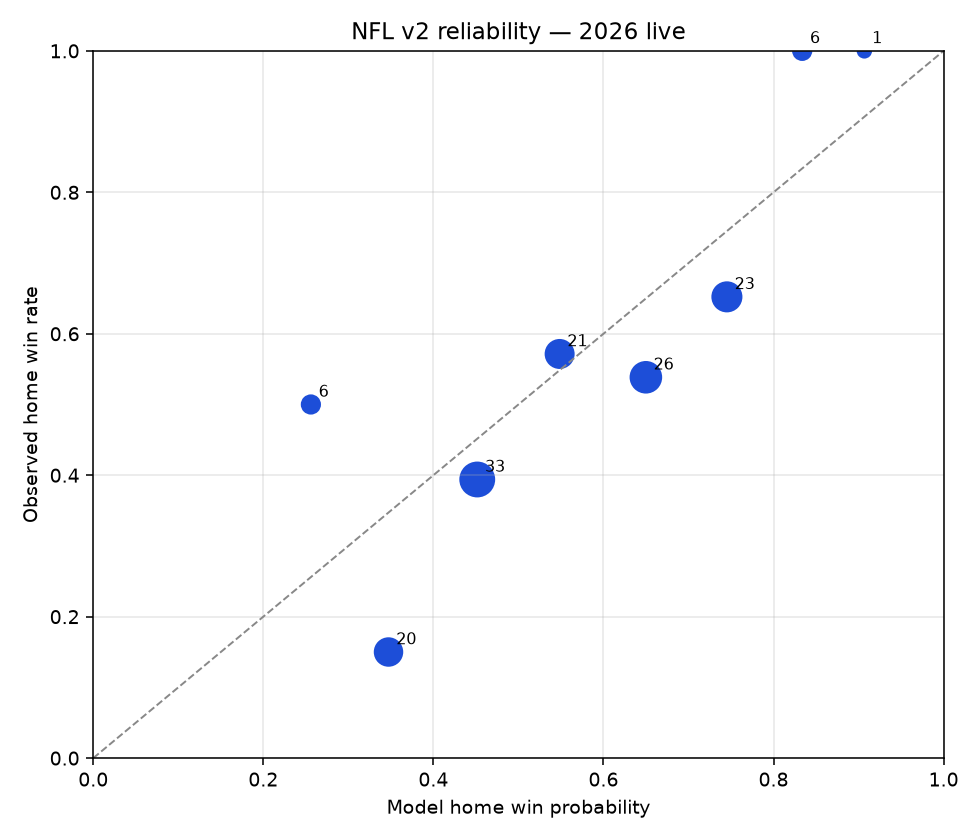
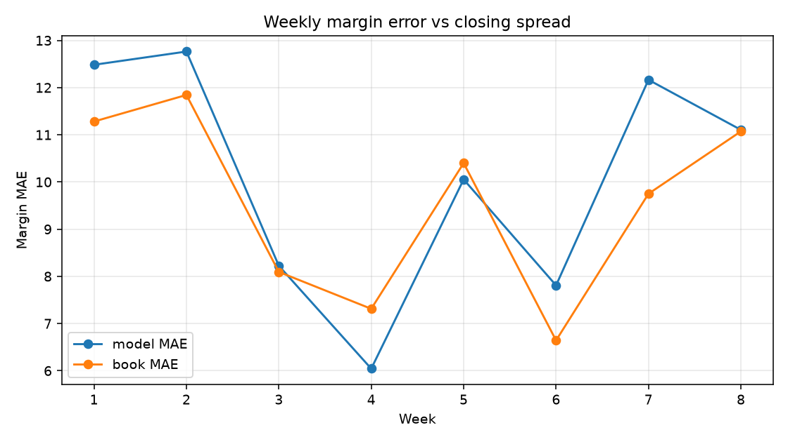
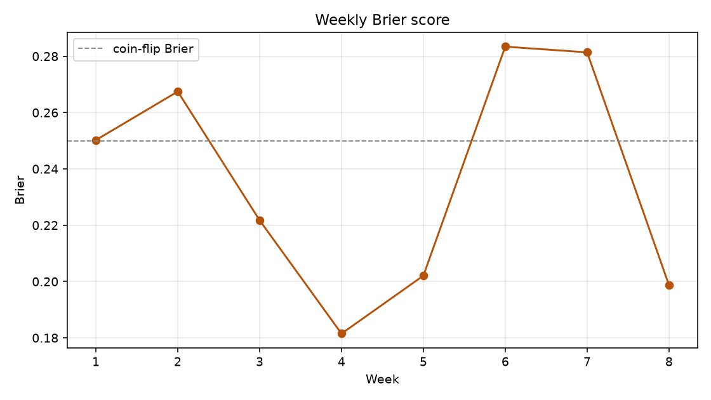

# NFL v2 model health — 2026

**Generated:** 2026-11-10T21:00:28.689869+00:00
**Model:** `nfl-v2-live-20261020`
**Graded 2026 games:** 136 (weeks 1, 2, 3, 4, 5, 6, 7, 8, 9)

This is a model-quality readout, not a betting strategy. Missing books stay model-only; no invented edge or EV.

## Headline vs the book

| Measure | Model | Closing / no-vig book |
| --- | ---: | ---: |
| Margin MAE | **9.87** | **9.42** |
| Margin RMSE | 12.55 | 11.95 |
| Home-margin bias | 1.86 | 1.85 |
| Brier | 0.2252 | 0.2167 |
| Log loss | 0.640 | 0.625 |
| ECE (10-bin) | 0.102 | 0.069 |
| Winner W-L | 88-48 (64.7%) | 67.6% favorite hit |
| ATS vs book, model side, -110 | 62-68-6 (-9.0% ROI) | — |
| ATS bootstrap 95% ROI | -0.248 to 0.076 | — |
| ML on model favorite | -0.71u / -0.5% | bootstrap -0.14 to 0.12 |

Totals: NFL v2 does not emit a game total. Book closing-total MAE is 10.60 on 136 games.

The book still wins MAE, RMSE, Brier, log loss, and ECE. ATS ROI CIs include zero. Do not read this as a tradable edge.

## Oct 15–18 slate

n=13, model MAE 7.79 / RMSE 8.75 vs book 7.04 / 7.99. Close games (≤3 pts) 1-4. Winner 6-7. Unique model probabilities: 13. Recomputed from the frozen artifact plus nflverse finals; ESPN had zero score disagreements on matched games.

## Prediction source

- Stored pre-kickoff rows used: **43**
- Artifact reconstructions used: **93**
- Public `/models/results` winner W-L mentioned: None; model-line ATS mentioned: None
- ESPN matched finals: 108 of 136 with **0 score disagreements**

This environment had no Supabase password, so the live number is the frozen `nfl_v2_live.joblib` reconstruction on leakage-safe pregame features — the same path Daily Refresh uses. Public winner W-L is 51-41 on 92 games, which matches this reconstruction. Public model-line ATS is 39-53 vs reconstructed model-line ~40-52; that one-game gap is rounding of stored `my_spread`, not a second model. Book ATS below uses nflverse closing home spreads (`home_spread = -spread_line`), not the Tuesday Odds API snapshot.

WAS@SF (Mon 2026-10-19) was not final at scoring time and is excluded.

## Reliability

| Bucket | n | Mean p | Actual | Bias |
| --- | ---: | ---: | ---: | ---: |
| (0.2, 0.3] | 6 | 0.256 | 0.500 | -0.244 |
| (0.3, 0.4] | 20 | 0.347 | 0.150 | 0.197 |
| (0.4, 0.5] | 33 | 0.452 | 0.394 | 0.058 |
| (0.5, 0.6] | 21 | 0.548 | 0.571 | -0.023 |
| (0.6, 0.7] | 26 | 0.650 | 0.538 | 0.111 |
| (0.7, 0.8] | 23 | 0.745 | 0.652 | 0.093 |
| (0.8, 0.9] | 6 | 0.834 | 1.000 | -0.166 |
| (0.9, 1.0] | 1 | 0.907 | 1.000 | -0.093 |





## Breakouts

### Week

| Segment | n | Brier | ECE | MAE | Home-prob bias | Book ATS | ML units |
| --- | ---: | ---: | ---: | ---: | ---: | --- | ---: |
| week_1 | 16 | 0.250 | 0.126 | 12.48 | -0.062 | 6-9-1 | -4.2 |
| week_2 | 16 | 0.267 | 0.150 | 12.76 | 0.145 | 7-9 | -3.5 |
| week_3 | 16 | 0.222 | 0.189 | 8.22 | -0.146 | 8-6-2 | 0.6 |
| week_4 | 16 | 0.181 | 0.171 | 6.04 | 0.072 | 9-5-2 | 3.1 |
| week_5 | 15 | 0.202 | 0.243 | 10.05 | 0.163 | 7-7-1 | 5.7 |
| week_6 | 14 | 0.283 | 0.314 | 7.81 | 0.152 | 4-10 | -3.4 |
| week_7 | 14 | 0.281 | 0.281 | 12.16 | 0.161 | 3-11 | -3.4 |
| week_8 | 14 | 0.199 | 0.163 | 11.11 | -0.118 | 10-4 | 1.2 |
| week_9 | 15 | 0.145 | 0.295 | 8.25 | 0.168 | 8-7 | 3.1 |

### Favorite vs dog

| Segment | n | Brier | ECE | MAE | Home-prob bias | Book ATS | ML units |
| --- | ---: | ---: | ---: | ---: | ---: | --- | ---: |
| model_favorite | 77 | 0.227 | 0.086 | 10.59 | 0.045 | 36-38-3 | -6.9 |
| model_dog | 59 | 0.223 | 0.124 | 8.92 | 0.074 | 26-30-3 | 6.2 |
| book_home_favorite | 81 | 0.228 | 0.105 | 10.28 | -0.001 | 40-38-3 | -5.7 |
| book_home_dog | 55 | 0.221 | 0.197 | 9.27 | 0.144 | 22-30-3 | 5.0 |

### Home vs away (ATS side and win-prob side)

| Segment | n | Brier | ECE | MAE | Home-prob bias | Book ATS | ML units |
| --- | ---: | ---: | ---: | ---: | ---: | --- | ---: |
| ats_bet_home | 71 | 0.218 | 0.187 | 10.21 | 0.135 | 27-41-3 | -0.7 |
| ats_bet_away | 65 | 0.233 | 0.108 | 9.49 | -0.027 | 35-27-3 | -0.0 |
| home_win_prob_side | 77 | 0.227 | 0.086 | 10.59 | 0.045 | 36-38-3 | -6.9 |
| away_win_prob_side | 59 | 0.223 | 0.124 | 8.92 | 0.074 | 26-30-3 | 6.2 |

### Confidence (|p−0.5|)

| Segment | n | Brier | ECE | MAE | Home-prob bias | Book ATS | ML units |
| --- | ---: | ---: | ---: | ---: | ---: | --- | ---: |
| confidence_coin | 30 | 0.248 | 0.075 | 8.34 | 0.027 | 15-14-1 | 1.3 |
| confidence_lean | 24 | 0.243 | 0.025 | 10.25 | 0.025 | 8-14-2 | 1.5 |
| confidence_moderate | 24 | 0.222 | 0.074 | 12.14 | 0.074 | 12-12 | 0.9 |
| confidence_strong | 38 | 0.252 | 0.226 | 10.56 | 0.203 | 16-20-2 | -5.7 |
| confidence_heavy | 20 | 0.123 | 0.154 | 7.65 | -0.154 | 11-8-1 | 1.3 |

## Diagnosis

The model is **overconfident on favorites** and **home-biased on the margin**, not just unlucky on one slate.

- Home-probability bias: **0.058** (alert >0.03)
- Home-margin bias: **1.86** points (alert >0.75)
- ECE: **0.102** vs 0.05 live-rollout alert; book ECE 0.069
- Unique win probabilities on 92 games: **136** — the production isotonic map is coarse, especially on weekly slates
- Close games (≤3 pts): 29 games, winner hit 58.6%
- Leakage audit: ready=True, leakage_rows=0, duplicate_rows=0, feature rows=1965
- Feature-history lag: mean home 35.4 days. Week 1 using last season's final game is expected (offseason), not a stale PBP ingest. Max lag 253 days is Super Bowl → opening week.
- Prediction timestamps: not available without stored `asof_ts`. Daily Refresh froze this cycle on Tuesday 2026-10-13 and does not reopen the team model mid-week.
- Feature drift vs 2025 REG: largest absolute shift is travel distance; standardized z-scores are ~0.1. No smoking-gun covariate shift.
- Injuries / posted QB still excluded. Expected QB is the mode of the last three PBP dropback QBs. That is a known serving limitation, not a leakage bug.

### Early-season prior decay

| Week | Typical games | 3-game current / last / league | 10-game current |
| ---: | ---: | --- | ---: |
| 1 | 0 | 0.0% / 68.0% / 32.0% | 0.0% |
| 2 | 1 | 20.0% / 54.4% / 25.6% | 20.0% |
| 3 | 2 | 33.3% / 45.3% / 21.3% | 33.3% |
| 4 | 3 | 42.9% / 38.9% / 18.3% | 42.9% |
| 5 | 4 | 42.9% / 38.9% / 18.3% | 50.0% |
| 6 | 5 | 42.9% / 38.9% / 18.3% | 55.6% |
| 7 | 6 | 42.9% / 38.9% / 18.3% | 60.0% |
| 8 | 7 | 42.9% / 38.9% / 18.3% | 63.6% |
| 9 | 8 | 42.9% / 38.9% / 18.3% | 66.7% |

The 3-game window never grows past three observations, so after week 4 it stays ~43% current / ~39% last season / ~18% league average. 5- and 10-game windows add current-season mass as designed. Changing the prior weight would require a retrain; this health check does not ad-hoc retune it.

## Recalibration (walk-forward, fit never sees the scored week)

Expanding-week fits on weeks 1…k−1, scored on week k, pooled OOS once 40 training rows exist.

| Method | OOS n | Δ Brier | Δ log loss | Status |
| --- | ---: | ---: | ---: | --- |
| temperature | 88 | 0.0071 | 0.0176 | ok |
| platt | 88 | 0.0077 | 0.0187 | ok |
| isotonic | 88 | -0.0003 | 0.1168 | ok |
| market_shrink | 88 | 0.0004 | 0.0014 | ok |

| Method | OOS n | Δ MAE | Δ RMSE |
| --- | ---: | ---: | ---: |
| scale | 88 | 0.091 | 0.140 |
| affine | 88 | -0.017 | 0.114 |

**Shipped to live serving: no.** No walk-forward probability method improved OOS Brier and log loss enough without using scored games.

Temperature, Platt, extra isotonic, and market-shrink all failed the Brier+log-loss gate. Margin scale/affine can trim OOS MAE; that is not enough to ship without a probability win.

Code for those transforms lives behind `NFL_V2_POSTHOC_CALIBRATION` (default **off**). Rollback if a later run ships: `NFL_V2_DISABLE_POSTHOC_CALIBRATION=1`. Live Daily Refresh publishes `nfl-v2-live-20261020` (`Phi(-spread/σ)`); HGB/ridge stay the 20260906 pickle.

No serving change. `predict_live_games` still emits frozen ridge spreads and margin-normal win probability (`nfl-v2-live-20261020`) unless `NFL_V2_POSTHOC_CALIBRATION` is explicitly enabled *and* a shipped artifact exists.

## Recommendation

1. Keep the frozen live artifact. Do not mid-season-recalibrate on 2026 games.
2. Next modeling lever is posted-QB / injury identity with timestamped history, not another probability spline on n=92.
3. Re-run this script weekly; promote a post-hoc calibrator only if walk-forward Brier **and** log loss improve without a MAE regression.

## 2025

2025 reconstructed through the frozen live artifact is **in-sample** (trained_through=2025), n=272. Brier 0.2152, MAE 9.99, book ATS 147-124-1. Stored v1 ATS is 27-29 on 56 games.

Stored 2025 Supabase ATS (`nfl_supabase_ats_games_2025.csv`) is **v1**, 27-29, not v2.

## Weekly recompute

```bash
PYTHONPATH=data-core python data-core/scripts/nfl_model_health.py
```

Performance History Refresh runs this after `grade_nfl_v2_live.py`. With Supabase credentials it prefers stored pre-kickoff rows; without them it reconstructs the artifact.

Artifacts: `data-core/notebooks/cache/nfl_model_health_2026.json`, `nfl_model_health_2026_games.csv`.

