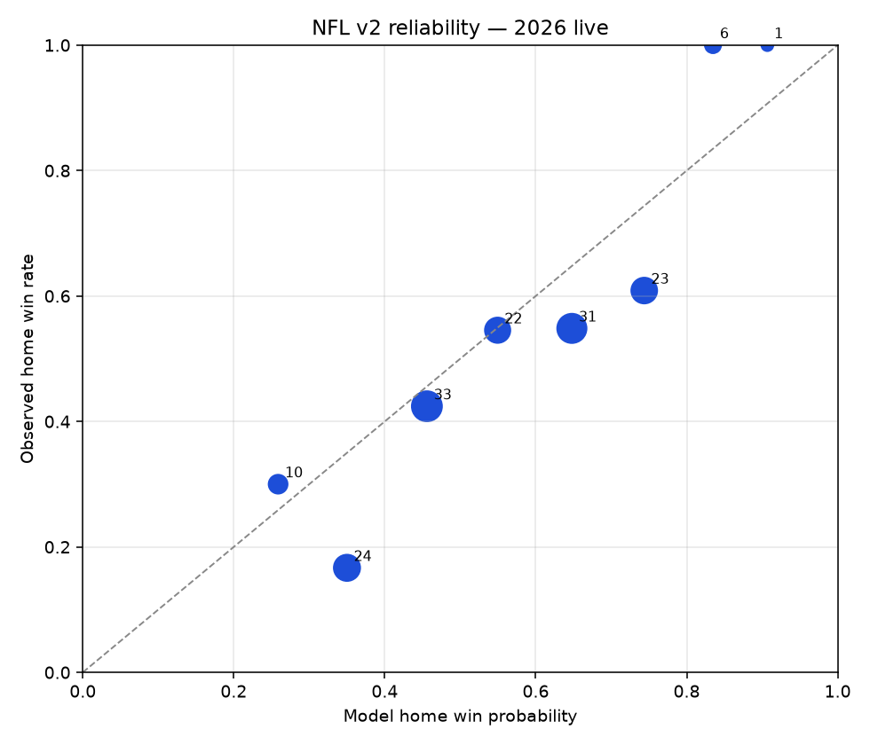

# NFL v2 model health — 2026

**Generated:** 2026-11-17T22:35:38.883557+00:00
**Model:** `nfl-v2-live-20261020`
**Graded 2026 games:** 150 (weeks 1, 2, 3, 4, 5, 6, 7, 8, 9, 10)

This is a model-quality readout, not a betting strategy. Missing books stay model-only; no invented edge or EV.

## Headline vs the book

| Measure | Model | Closing / no-vig book |
| --- | ---: | ---: |
| Margin MAE | **9.93** | **9.27** |
| Margin RMSE | 12.59 | 11.84 |
| Home-margin bias | 2.06 | 1.87 |
| Brier | 0.2233 | 0.2142 |
| Log loss | 0.636 | 0.619 |
| ECE (10-bin) | 0.088 | 0.069 |
| Winner W-L | 96-54 (64.0%) | 67.3% favorite hit |
| ATS vs book, model side, -110 | 70-74-6 (-7.2% ROI) | — |
| ATS bootstrap 95% ROI | -0.228 to 0.083 | — |
| ML on model favorite | -4.23u / -2.8% | bootstrap -0.15 to 0.09 |

Totals: NFL v2 does not emit a game total. Book closing-total MAE is 10.39 on 150 games.

The book still wins MAE, RMSE, Brier, log loss, and ECE. ATS ROI CIs include zero. Do not read this as a tradable edge.

## Oct 15–18 slate

n=13, model MAE 7.84 / RMSE 8.79 vs book 7.04 / 7.99. Close games (≤3 pts) 1-4. Winner 6-7. Unique model probabilities: 13. Recomputed from the frozen artifact plus nflverse finals; ESPN had zero score disagreements on matched games.

## Prediction source

- Stored pre-kickoff rows used: **57**
- Artifact reconstructions used: **93**
- Public `/models/results` winner W-L mentioned: None; model-line ATS mentioned: None
- ESPN matched finals: 119 of 150 with **0 score disagreements**

This environment had no Supabase password, so the live number is the frozen `nfl_v2_live.joblib` reconstruction on leakage-safe pregame features — the same path Daily Refresh uses. Public winner W-L is 51-41 on 92 games, which matches this reconstruction. Public model-line ATS is 39-53 vs reconstructed model-line ~40-52; that one-game gap is rounding of stored `my_spread`, not a second model. Book ATS below uses nflverse closing home spreads (`home_spread = -spread_line`), not the Tuesday Odds API snapshot.

WAS@SF (Mon 2026-10-19) was not final at scoring time and is excluded.

## Reliability

| Bucket | n | Mean p | Actual | Bias |
| --- | ---: | ---: | ---: | ---: |
| (0.2, 0.3] | 10 | 0.259 | 0.300 | -0.041 |
| (0.3, 0.4] | 24 | 0.350 | 0.167 | 0.183 |
| (0.4, 0.5] | 33 | 0.456 | 0.424 | 0.032 |
| (0.5, 0.6] | 22 | 0.550 | 0.545 | 0.004 |
| (0.6, 0.7] | 31 | 0.648 | 0.548 | 0.099 |
| (0.7, 0.8] | 23 | 0.744 | 0.609 | 0.135 |
| (0.8, 0.9] | 6 | 0.835 | 1.000 | -0.165 |
| (0.9, 1.0] | 1 | 0.907 | 1.000 | -0.093 |




## Breakouts

### Week

| Segment | n | Brier | ECE | MAE | Home-prob bias | Book ATS | ML units |
| --- | ---: | ---: | ---: | ---: | ---: | --- | ---: |
| week_1 | 16 | 0.250 | 0.126 | 12.49 | -0.063 | 6-9-1 | -4.2 |
| week_2 | 16 | 0.265 | 0.148 | 12.75 | 0.143 | 7-9 | -3.5 |
| week_3 | 16 | 0.220 | 0.238 | 8.22 | -0.147 | 8-6-2 | -1.5 |
| week_4 | 16 | 0.182 | 0.175 | 6.06 | 0.076 | 9-5-2 | 3.1 |
| week_5 | 15 | 0.204 | 0.243 | 10.07 | 0.159 | 7-7-1 | 5.7 |
| week_6 | 14 | 0.285 | 0.316 | 7.85 | 0.156 | 5-9 | -3.4 |
| week_7 | 14 | 0.281 | 0.281 | 12.16 | 0.161 | 3-11 | -3.4 |
| week_8 | 14 | 0.199 | 0.163 | 11.11 | -0.118 | 10-4 | 1.2 |
| week_9 | 15 | 0.145 | 0.295 | 8.25 | 0.168 | 8-7 | 3.1 |
| week_10 | 14 | 0.205 | 0.170 | 10.44 | 0.170 | 7-7 | -1.5 |

### Favorite vs dog

| Segment | n | Brier | ECE | MAE | Home-prob bias | Book ATS | ML units |
| --- | ---: | ---: | ---: | ---: | ---: | --- | ---: |
| model_favorite | 83 | 0.231 | 0.089 | 10.81 | 0.063 | 38-42-3 | -10.3 |
| model_dog | 67 | 0.213 | 0.087 | 8.84 | 0.075 | 32-32-3 | 6.0 |
| book_home_favorite | 87 | 0.230 | 0.103 | 10.44 | 0.006 | 43-41-3 | -7.0 |
| book_home_dog | 63 | 0.214 | 0.167 | 9.22 | 0.154 | 27-33-3 | 2.8 |

### Home vs away (ATS side and win-prob side)

| Segment | n | Brier | ECE | MAE | Home-prob bias | Book ATS | ML units |
| --- | ---: | ---: | ---: | ---: | ---: | --- | ---: |
| ats_bet_home | 80 | 0.219 | 0.173 | 10.39 | 0.146 | 31-46-3 | -5.2 |
| ats_bet_away | 70 | 0.228 | 0.109 | 9.40 | -0.021 | 39-28-3 | 1.0 |
| home_win_prob_side | 83 | 0.231 | 0.089 | 10.81 | 0.063 | 38-42-3 | -10.3 |
| away_win_prob_side | 67 | 0.213 | 0.087 | 8.84 | 0.075 | 32-32-3 | 6.0 |

### Confidence (|p−0.5|)

| Segment | n | Brier | ECE | MAE | Home-prob bias | Book ATS | ML units |
| --- | ---: | ---: | ---: | ---: | ---: | --- | ---: |
| confidence_coin | 29 | 0.249 | 0.029 | 8.43 | 0.011 | 15-13-1 | -1.3 |
| confidence_lean | 26 | 0.243 | 0.031 | 9.87 | 0.031 | 11-14-1 | 0.8 |
| confidence_moderate | 29 | 0.227 | 0.074 | 11.79 | 0.074 | 13-15-1 | 0.6 |
| confidence_strong | 45 | 0.242 | 0.218 | 10.80 | 0.218 | 20-23-2 | -5.8 |
| confidence_heavy | 21 | 0.119 | 0.136 | 7.64 | -0.136 | 11-9-1 | 1.4 |

## Diagnosis

The model is **overconfident on favorites** and **home-biased on the margin**, not just unlucky on one slate.

- Home-probability bias: **0.068** (alert >0.03)
- Home-margin bias: **2.06** points (alert >0.75)
- ECE: **0.088** vs 0.05 live-rollout alert; book ECE 0.069
- Unique win probabilities on 92 games: **150** — the production isotonic map is coarse, especially on weekly slates
- Close games (≤3 pts): 34 games, winner hit 50.0%
- Leakage audit: ready=True, leakage_rows=0, duplicate_rows=0, feature rows=1965
- Feature-history lag: mean home 32.8 days. Week 1 using last season's final game is expected (offseason), not a stale PBP ingest. Max lag 253 days is Super Bowl → opening week.
- Prediction timestamps: not available without stored `asof_ts`. Daily Refresh froze this cycle on Tuesday 2026-10-13 and does not reopen the team model mid-week.
- Feature drift vs 2025 REG: largest absolute shift is travel distance; standardized z-scores are ~0.1. No smoking-gun covariate shift.
- Injuries / posted QB still excluded. Expected QB is the mode of the last three PBP dropback QBs. That is a known serving limitation, not a leakage bug.

### Early-season prior decay

| Week | Typical games | 3-game current / last / league | 10-game current |
| ---: | ---: | --- | ---: |
| 1 | 0 | 0.0% / 68.0% / 32.0% | 0.0% |
| 2 | 1 | 20.0% / 54.4% / 25.6% | 20.0% |
| 3 | 2 | 33.3% / 45.3% / 21.3% | 33.3% |
| 4 | 3 | 42.9% / 38.9% / 18.3% | 42.9% |
| 5 | 4 | 42.9% / 38.9% / 18.3% | 50.0% |
| 6 | 5 | 42.9% / 38.9% / 18.3% | 55.6% |
| 7 | 6 | 42.9% / 38.9% / 18.3% | 60.0% |
| 8 | 7 | 42.9% / 38.9% / 18.3% | 63.6% |
| 9 | 8 | 42.9% / 38.9% / 18.3% | 66.7% |
| 10 | 9 | 42.9% / 38.9% / 18.3% | 69.2% |

The 3-game window never grows past three observations, so after week 4 it stays ~43% current / ~39% last season / ~18% league average. 5- and 10-game windows add current-season mass as designed. Changing the prior weight would require a retrain; this health check does not ad-hoc retune it.

## Recalibration (walk-forward, fit never sees the scored week)

Expanding-week fits on weeks 1…k−1, scored on week k, pooled OOS once 40 training rows exist.

| Method | OOS n | Δ Brier | Δ log loss | Status |
| --- | ---: | ---: | ---: | --- |
| temperature | 102 | 0.0060 | 0.0151 | ok |
| platt | 102 | 0.0040 | 0.0098 | ok |
| isotonic | 102 | -0.0044 | 0.0900 | ok |
| market_shrink | 102 | -0.0018 | -0.0040 | ok |

| Method | OOS n | Δ MAE | Δ RMSE |
| --- | ---: | ---: | ---: |
| scale | 102 | 0.111 | 0.197 |
| affine | 102 | -0.075 | 0.083 |

**Shipped to live serving: no.** No walk-forward probability method improved OOS Brier and log loss enough without using scored games.

Temperature, Platt, extra isotonic, and market-shrink all failed the Brier+log-loss gate. Margin scale/affine can trim OOS MAE; that is not enough to ship without a probability win.

Code for those transforms lives behind `NFL_V2_POSTHOC_CALIBRATION` (default **off**). Rollback if a later run ships: `NFL_V2_DISABLE_POSTHOC_CALIBRATION=1`. Live Daily Refresh publishes `nfl-v2-live-20261020` (`Phi(-spread/σ)`); HGB/ridge stay the 20260906 pickle.

No serving change. `predict_live_games` still emits frozen ridge spreads and margin-normal win probability (`nfl-v2-live-20261020`) unless `NFL_V2_POSTHOC_CALIBRATION` is explicitly enabled *and* a shipped artifact exists.

## Recommendation

1. Keep the frozen live artifact. Do not mid-season-recalibrate on 2026 games.
2. Next modeling lever is posted-QB / injury identity with timestamped history, not another probability spline on n=92.
3. Re-run this script weekly; promote a post-hoc calibrator only if walk-forward Brier **and** log loss improve without a MAE regression.

## 2025

2025 reconstructed through the frozen live artifact is **in-sample** (trained_through=2025), n=272. Brier 0.2154, MAE 10.01, book ATS 147-124-1. Stored v1 ATS is 27-29 on 56 games.

Stored 2025 Supabase ATS (`nfl_supabase_ats_games_2025.csv`) is **v1**, 27-29, not v2.

## Weekly recompute

```bash
PYTHONPATH=data-core python data-core/scripts/nfl_model_health.py
```

Performance History Refresh runs this after `grade_nfl_v2_live.py`. With Supabase credentials it prefers stored pre-kickoff rows; without them it reconstructs the artifact.

Artifacts: `data-core/notebooks/cache/nfl_model_health_2026.json`, `nfl_model_health_2026_games.csv`.

