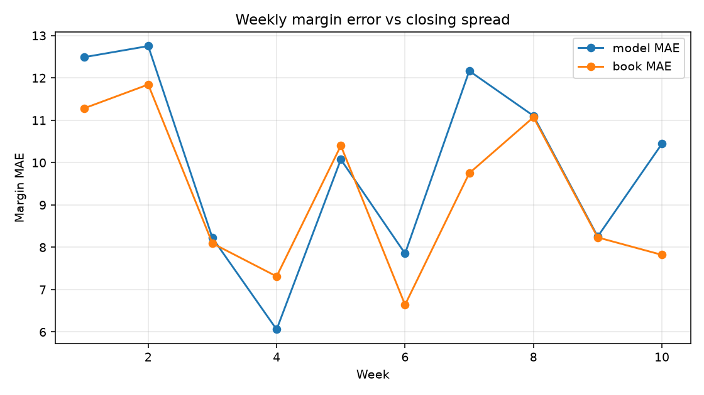
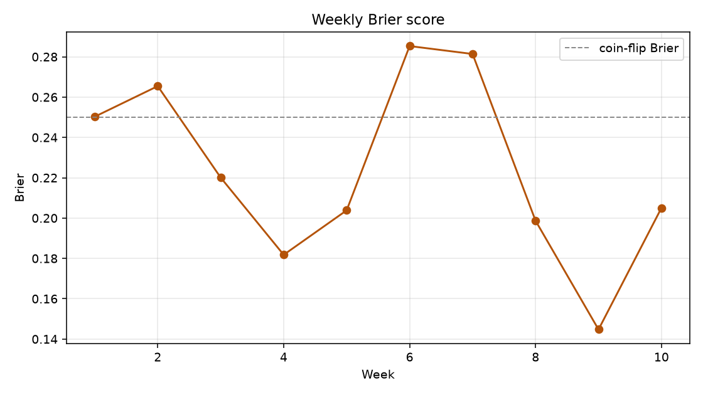

# NFL v2 model health — 2026

**Generated:** 2026-11-24T23:37:52.967139+00:00
**Model:** `nfl-v2-live-20261020`
**Graded 2026 games:** 163 (weeks 1, 2, 3, 4, 5, 6, 7, 8, 9, 10, 11)

This is a model-quality readout, not a betting strategy. Missing books stay model-only; no invented edge or EV.

## Headline vs the book

| Measure | Model | Closing / no-vig book |
| --- | ---: | ---: |
| Margin MAE | **9.79** | **9.10** |
| Margin RMSE | 12.40 | 11.65 |
| Home-margin bias | 1.34 | 1.28 |
| Brier | 0.2196 | 0.2116 |
| Log loss | 0.627 | 0.612 |
| ECE (10-bin) | 0.070 | 0.044 |
| Winner W-L | 105-58 (64.4%) | 67.5% favorite hit |
| ATS vs book, model side, -110 | 77-80-6 (-6.4% ROI) | — |
| ATS bootstrap 95% ROI | -0.207 to 0.084 | — |
| ML on model favorite | -4.68u / -2.9% | bootstrap -0.15 to 0.09 |

Totals: NFL v2 does not emit a game total. Book closing-total MAE is 10.44 on 163 games.

The book still wins MAE, RMSE, Brier, log loss, and ECE. ATS ROI CIs include zero. Do not read this as a tradable edge.

## Oct 15–18 slate

n=13, model MAE 7.99 / RMSE 8.90 vs book 7.04 / 7.99. Close games (≤3 pts) 1-4. Winner 6-7. Unique model probabilities: 13. Recomputed from the frozen artifact plus nflverse finals; ESPN had zero score disagreements on matched games.

## Prediction source

- Stored pre-kickoff rows used: **70**
- Artifact reconstructions used: **93**
- Public `/models/results` winner W-L mentioned: None; model-line ATS mentioned: None
- ESPN matched finals: 129 of 163 with **0 score disagreements**

This environment had no Supabase password, so the live number is the frozen `nfl_v2_live.joblib` reconstruction on leakage-safe pregame features — the same path Daily Refresh uses. Public winner W-L is 51-41 on 92 games, which matches this reconstruction. Public model-line ATS is 39-53 vs reconstructed model-line ~40-52; that one-game gap is rounding of stored `my_spread`, not a second model. Book ATS below uses nflverse closing home spreads (`home_spread = -spread_line`), not the Tuesday Odds API snapshot.

WAS@SF (Mon 2026-10-19) was not final at scoring time and is excluded.

## Reliability

| Bucket | n | Mean p | Actual | Bias |
| --- | ---: | ---: | ---: | ---: |
| (0.2, 0.3] | 12 | 0.266 | 0.417 | -0.151 |
| (0.3, 0.4] | 26 | 0.351 | 0.192 | 0.159 |
| (0.4, 0.5] | 30 | 0.454 | 0.433 | 0.021 |
| (0.5, 0.6] | 27 | 0.547 | 0.556 | -0.009 |
| (0.6, 0.7] | 32 | 0.652 | 0.531 | 0.121 |
| (0.7, 0.8] | 27 | 0.751 | 0.741 | 0.010 |
| (0.8, 0.9] | 8 | 0.835 | 0.875 | -0.040 |
| (0.9, 1.0] | 1 | 0.907 | 1.000 | -0.093 |





## Breakouts

### Week

| Segment | n | Brier | ECE | MAE | Home-prob bias | Book ATS | ML units |
| --- | ---: | ---: | ---: | ---: | ---: | --- | ---: |
| week_1 | 16 | 0.250 | 0.126 | 12.49 | -0.063 | 6-9-1 | -4.2 |
| week_2 | 16 | 0.265 | 0.231 | 12.79 | 0.143 | 8-8 | -3.5 |
| week_3 | 16 | 0.223 | 0.292 | 8.26 | -0.152 | 8-6-2 | 0.6 |
| week_4 | 16 | 0.182 | 0.124 | 6.13 | 0.075 | 8-6-2 | 1.1 |
| week_5 | 15 | 0.207 | 0.193 | 10.21 | 0.164 | 7-7-1 | 4.2 |
| week_6 | 14 | 0.289 | 0.257 | 7.98 | 0.151 | 5-9 | -3.4 |
| week_7 | 14 | 0.281 | 0.281 | 12.16 | 0.161 | 3-11 | -3.4 |
| week_8 | 14 | 0.199 | 0.163 | 11.11 | -0.118 | 10-4 | 1.2 |
| week_9 | 15 | 0.145 | 0.295 | 8.25 | 0.168 | 8-7 | 3.0 |
| week_10 | 14 | 0.205 | 0.170 | 10.44 | 0.170 | 7-7 | -1.5 |
| week_11 | 13 | 0.166 | 0.362 | 7.67 | -0.286 | 7-6 | 1.1 |

### Favorite vs dog

| Segment | n | Brier | ECE | MAE | Home-prob bias | Book ATS | ML units |
| --- | ---: | ---: | ---: | ---: | ---: | --- | ---: |
| model_favorite | 95 | 0.217 | 0.050 | 10.53 | 0.037 | 46-46-3 | -8.8 |
| model_dog | 68 | 0.223 | 0.096 | 8.74 | 0.043 | 31-34-3 | 4.1 |
| book_home_favorite | 97 | 0.217 | 0.060 | 10.17 | -0.012 | 50-44-3 | -5.1 |
| book_home_dog | 66 | 0.224 | 0.149 | 9.22 | 0.115 | 27-36-3 | 0.4 |

### Home vs away (ATS side and win-prob side)

| Segment | n | Brier | ECE | MAE | Home-prob bias | Book ATS | ML units |
| --- | ---: | ---: | ---: | ---: | ---: | --- | ---: |
| ats_bet_home | 82 | 0.208 | 0.141 | 10.22 | 0.114 | 34-45-3 | -1.2 |
| ats_bet_away | 81 | 0.231 | 0.109 | 9.34 | -0.036 | 43-35-3 | -3.5 |
| home_win_prob_side | 95 | 0.217 | 0.050 | 10.53 | 0.037 | 46-46-3 | -8.8 |
| away_win_prob_side | 68 | 0.223 | 0.096 | 8.74 | 0.043 | 31-34-3 | 4.1 |

### Confidence (|p−0.5|)

| Segment | n | Brier | ECE | MAE | Home-prob bias | Book ATS | ML units |
| --- | ---: | ---: | ---: | ---: | ---: | --- | ---: |
| confidence_coin | 35 | 0.248 | 0.068 | 8.38 | 0.068 | 18-16-1 | 0.5 |
| confidence_lean | 22 | 0.249 | 0.091 | 11.02 | -0.091 | 10-11-1 | -0.1 |
| confidence_moderate | 30 | 0.250 | 0.100 | 11.07 | 0.100 | 13-16-1 | -3.4 |
| confidence_strong | 49 | 0.231 | 0.186 | 10.59 | 0.115 | 23-24-2 | -4.6 |
| confidence_heavy | 27 | 0.104 | 0.096 | 7.71 | -0.096 | 13-13-1 | 3.0 |

## Diagnosis

The model is **overconfident on favorites** and **home-biased on the margin**, not just unlucky on one slate.

- Home-probability bias: **0.039** (alert >0.03)
- Home-margin bias: **1.34** points (alert >0.75)
- ECE: **0.070** vs 0.05 live-rollout alert; book ECE 0.044
- Unique win probabilities on 92 games: **163** — the production isotonic map is coarse, especially on weekly slates
- Close games (≤3 pts): 38 games, winner hit 52.6%
- Leakage audit: ready=True, leakage_rows=0, duplicate_rows=0, feature rows=1965
- Feature-history lag: mean home 30.9 days. Week 1 using last season's final game is expected (offseason), not a stale PBP ingest. Max lag 253 days is Super Bowl → opening week.
- Prediction timestamps: not available without stored `asof_ts`. Daily Refresh froze this cycle on Tuesday 2026-10-13 and does not reopen the team model mid-week.
- Feature drift vs 2025 REG: largest absolute shift is travel distance; standardized z-scores are ~0.1. No smoking-gun covariate shift.
- Injuries / posted QB still excluded. Expected QB is the mode of the last three PBP dropback QBs. That is a known serving limitation, not a leakage bug.

### Early-season prior decay

| Week | Typical games | 3-game current / last / league | 10-game current |
| ---: | ---: | --- | ---: |
| 1 | 0 | 0.0% / 68.0% / 32.0% | 0.0% |
| 2 | 1 | 20.0% / 54.4% / 25.6% | 20.0% |
| 3 | 2 | 33.3% / 45.3% / 21.3% | 33.3% |
| 4 | 3 | 42.9% / 38.9% / 18.3% | 42.9% |
| 5 | 4 | 42.9% / 38.9% / 18.3% | 50.0% |
| 6 | 5 | 42.9% / 38.9% / 18.3% | 55.6% |
| 7 | 6 | 42.9% / 38.9% / 18.3% | 60.0% |
| 8 | 7 | 42.9% / 38.9% / 18.3% | 63.6% |
| 9 | 8 | 42.9% / 38.9% / 18.3% | 66.7% |
| 10 | 9 | 42.9% / 38.9% / 18.3% | 69.2% |
| 11 | 10 | 42.9% / 38.9% / 18.3% | 71.4% |

The 3-game window never grows past three observations, so after week 4 it stays ~43% current / ~39% last season / ~18% league average. 5- and 10-game windows add current-season mass as designed. Changing the prior weight would require a retrain; this health check does not ad-hoc retune it.

## Recalibration (walk-forward, fit never sees the scored week)

Expanding-week fits on weeks 1…k−1, scored on week k, pooled OOS once 40 training rows exist.

| Method | OOS n | Δ Brier | Δ log loss | Status |
| --- | ---: | ---: | ---: | --- |
| temperature | 115 | 0.0056 | 0.0141 | ok |
| platt | 115 | 0.0085 | 0.0206 | ok |
| isotonic | 115 | 0.0040 | 0.0959 | ok |
| market_shrink | 115 | -0.0011 | -0.0032 | ok |

| Method | OOS n | Δ MAE | Δ RMSE |
| --- | ---: | ---: | ---: |
| scale | 115 | 0.223 | 0.323 |
| affine | 115 | 0.133 | 0.272 |

**Shipped to live serving: no.** No walk-forward probability method improved OOS Brier and log loss enough without using scored games.

Temperature, Platt, extra isotonic, and market-shrink all failed the Brier+log-loss gate. Margin scale/affine can trim OOS MAE; that is not enough to ship without a probability win.

Code for those transforms lives behind `NFL_V2_POSTHOC_CALIBRATION` (default **off**). Rollback if a later run ships: `NFL_V2_DISABLE_POSTHOC_CALIBRATION=1`. Live Daily Refresh publishes `nfl-v2-live-20261020` (`Phi(-spread/σ)`); HGB/ridge stay the 20260906 pickle.

No serving change. `predict_live_games` still emits frozen ridge spreads and margin-normal win probability (`nfl-v2-live-20261020`) unless `NFL_V2_POSTHOC_CALIBRATION` is explicitly enabled *and* a shipped artifact exists.

## Recommendation

1. Keep the frozen live artifact. Do not mid-season-recalibrate on 2026 games.
2. Next modeling lever is posted-QB / injury identity with timestamped history, not another probability spline on n=92.
3. Re-run this script weekly; promote a post-hoc calibrator only if walk-forward Brier **and** log loss improve without a MAE regression.

## 2025

2025 reconstructed through the frozen live artifact is **in-sample** (trained_through=2025), n=272. Brier 0.2154, MAE 10.01, book ATS 147-124-1. Stored v1 ATS is 27-29 on 56 games.

Stored 2025 Supabase ATS (`nfl_supabase_ats_games_2025.csv`) is **v1**, 27-29, not v2.

## Weekly recompute

```bash
PYTHONPATH=data-core python data-core/scripts/nfl_model_health.py
```

Performance History Refresh runs this after `grade_nfl_v2_live.py`. With Supabase credentials it prefers stored pre-kickoff rows; without them it reconstructs the artifact.

Artifacts: `data-core/notebooks/cache/nfl_model_health_2026.json`, `nfl_model_health_2026_games.csv`.

