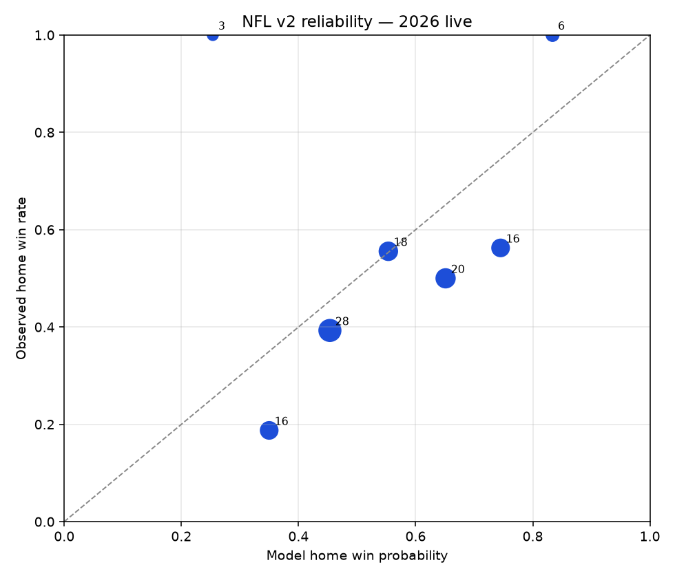
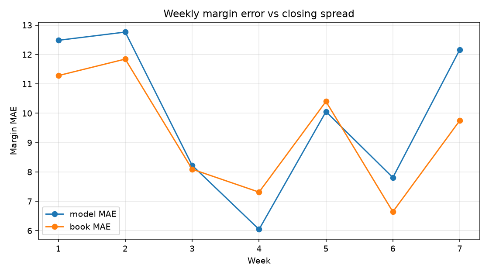
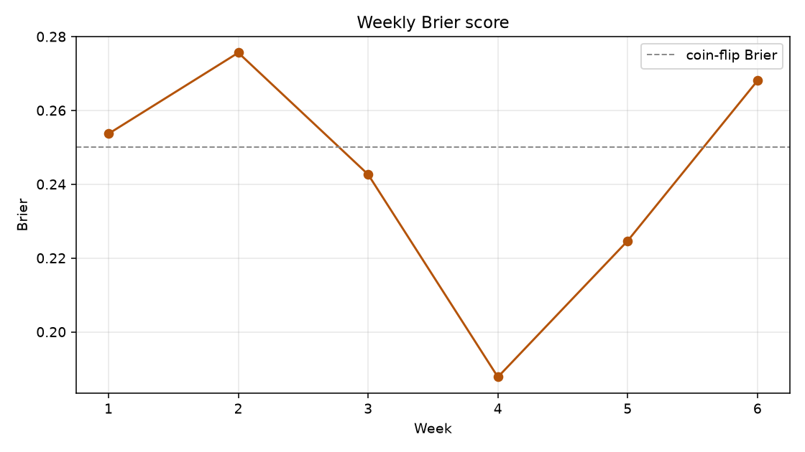

# NFL v2 model health — 2026

**Generated:** 2026-10-19T19:04:01.330593+00:00
**Model:** `nfl-v2-live-20260906`
**Graded 2026 games:** 92 (weeks 1, 2, 3, 4, 5, 6)

This is a model-quality readout, not a betting strategy. Missing books stay model-only; no invented edge or EV.

## Headline vs the book

| Measure | Model | Closing / no-vig book |
| --- | ---: | ---: |
| Margin MAE | **9.61** | **9.39** |
| Margin RMSE | 12.26 | 11.90 |
| Home-margin bias | 1.79 | 1.53 |
| Brier | 0.2414 | 0.2369 |
| Log loss | 0.677 | 0.669 |
| ECE (10-bin) | 0.088 | 0.056 |
| Winner W-L | 51-41 (55.4%) | 60.9% favorite hit |
| ATS vs book, model side, -110 | 41-45-6 (-9.0% ROI) | — |
| ATS bootstrap 95% ROI | -0.281 to 0.102 | — |
| ML on model favorite | -11.40u / -12.4% | bootstrap -0.29 to 0.05 |

Totals: NFL v2 does not emit a game total. Book closing-total MAE is 10.59 on 92 games.

The book still wins MAE, RMSE, Brier, log loss, and ECE. ATS ROI CIs include zero. Do not read this as a tradable edge.

## Oct 15–18 slate

n=13, model MAE 7.79 / RMSE 8.75 vs book 7.04 / 7.99. Close games (≤3 pts) 1-4. Winner 7-6. Unique model probabilities: 6. Recomputed from the frozen artifact plus nflverse finals; ESPN had zero score disagreements on matched games.

## Prediction source

- Stored pre-kickoff rows used: **0**
- Artifact reconstructions used: **92**
- Public `/models/results` winner W-L mentioned: 51-41; model-line ATS mentioned: 39-53
- ESPN matched finals: 74 of 92 with **0 score disagreements**

This environment had no Supabase password, so the live number is the frozen `nfl_v2_live.joblib` reconstruction on leakage-safe pregame features — the same path Daily Refresh uses. Public winner W-L is 51-41 on 92 games, which matches this reconstruction. Public model-line ATS is 39-53 vs reconstructed model-line ~40-52; that one-game gap is rounding of stored `my_spread`, not a second model. Book ATS below uses nflverse closing home spreads (`home_spread = -spread_line`), not the Tuesday Odds API snapshot.

WAS@SF (Mon 2026-10-19) was not final at scoring time and is excluded.

## Reliability

| Bucket | n | Mean p | Actual | Bias |
| --- | ---: | ---: | ---: | ---: |
| (0.3, 0.4] | 21 | 0.363 | 0.333 | 0.030 |
| (0.4, 0.5] | 33 | 0.477 | 0.515 | -0.038 |
| (0.5, 0.6] | 5 | 0.547 | 0.400 | 0.147 |
| (0.6, 0.7] | 13 | 0.658 | 0.538 | 0.120 |
| (0.7, 0.8] | 20 | 0.758 | 0.650 | 0.108 |





## Breakouts

### Week

| Segment | n | Brier | ECE | MAE | Home-prob bias | Book ATS | ML units |
| --- | ---: | ---: | ---: | ---: | ---: | --- | ---: |
| week_1 | 16 | 0.254 | 0.154 | 12.48 | -0.080 | 6-9-1 | -5.1 |
| week_2 | 16 | 0.276 | 0.140 | 12.76 | 0.137 | 7-9 | -4.9 |
| week_3 | 16 | 0.243 | 0.229 | 8.22 | -0.153 | 8-6-2 | -5.7 |
| week_4 | 16 | 0.188 | 0.212 | 6.04 | 0.053 | 9-5-2 | 1.3 |
| week_5 | 15 | 0.225 | 0.202 | 10.05 | 0.157 | 7-7-1 | 4.9 |
| week_6 | 13 | 0.268 | 0.198 | 7.79 | 0.168 | 4-9 | -2.0 |

### Favorite vs dog

| Segment | n | Brier | ECE | MAE | Home-prob bias | Book ATS | ML units |
| --- | ---: | ---: | ---: | ---: | ---: | --- | ---: |
| model_favorite | 41 | 0.247 | 0.140 | 10.88 | 0.121 | 18-19-4 | -9.4 |
| model_dog | 51 | 0.237 | 0.046 | 8.60 | -0.022 | 23-26-2 | -2.0 |
| book_home_favorite | 55 | 0.248 | 0.111 | 9.81 | 0.020 | 26-26-3 | -7.0 |
| book_home_dog | 37 | 0.231 | 0.123 | 9.31 | 0.074 | 15-19-3 | -4.4 |

### Home vs away (ATS side and win-prob side)

| Segment | n | Brier | ECE | MAE | Home-prob bias | Book ATS | ML units |
| --- | ---: | ---: | ---: | ---: | ---: | --- | ---: |
| ats_bet_home | 47 | 0.225 | 0.143 | 9.86 | 0.096 | 19-25-3 | -6.1 |
| ats_bet_away | 45 | 0.259 | 0.099 | 9.35 | -0.015 | 22-20-3 | -5.3 |
| home_win_prob_side | 41 | 0.247 | 0.140 | 10.88 | 0.121 | 18-19-4 | -9.4 |
| away_win_prob_side | 51 | 0.237 | 0.046 | 8.60 | -0.022 | 23-26-2 | -2.0 |

### Confidence (|p−0.5|)

| Segment | n | Brier | ECE | MAE | Home-prob bias | Book ATS | ML units |
| --- | ---: | ---: | ---: | ---: | ---: | --- | ---: |
| confidence_coin | 25 | 0.252 | 0.145 | 7.92 | -0.064 | 14-9-2 | -6.6 |
| confidence_lean | 13 | 0.238 | 0.085 | 10.11 | 0.085 | 6-6-1 | 0.8 |
| confidence_moderate | 20 | 0.228 | 0.078 | 9.49 | 0.078 | 5-14-1 | -0.7 |
| confidence_strong | 18 | 0.237 | 0.079 | 12.82 | 0.025 | 7-10-1 | -2.6 |
| confidence_heavy | 16 | 0.250 | 0.197 | 8.40 | 0.147 | 9-6-1 | -2.4 |

## Diagnosis

The model is **overconfident on favorites** and **home-biased on the margin**, not just unlucky on one slate.

- Home-probability bias: **0.042** (alert >0.03)
- Home-margin bias: **1.79** points (alert >0.75)
- ECE: **0.088** vs 0.05 live-rollout alert; book ECE 0.056
- Unique win probabilities on 92 games: **17** — the production isotonic map is coarse, especially on weekly slates
- Close games (≤3 pts): 23 games, winner hit 47.8%
- Leakage audit: ready=True, leakage_rows=0, duplicate_rows=0, feature rows=1965
- Feature-history lag: mean home 48.5 days. Week 1 using last season's final game is expected (offseason), not a stale PBP ingest. Max lag 253 days is Super Bowl → opening week.
- Prediction timestamps: not available without stored `asof_ts`. Daily Refresh froze this cycle on Tuesday 2026-10-13 and does not reopen the team model mid-week.
- Feature drift vs 2025 REG: largest absolute shift is travel distance; standardized z-scores are ~0.1. No smoking-gun covariate shift.
- Injuries / posted QB still excluded. Expected QB is the mode of the last three PBP dropback QBs. That is a known serving limitation, not a leakage bug.

### Early-season prior decay

| Week | Typical games | 3-game current / last / league | 10-game current |
| ---: | ---: | --- | ---: |
| 1 | 0 | 0.0% / 68.0% / 32.0% | 0.0% |
| 2 | 1 | 20.0% / 54.4% / 25.6% | 20.0% |
| 3 | 2 | 33.3% / 45.3% / 21.3% | 33.3% |
| 4 | 3 | 42.9% / 38.9% / 18.3% | 42.9% |
| 5 | 4 | 42.9% / 38.9% / 18.3% | 50.0% |
| 6 | 5 | 42.9% / 38.9% / 18.3% | 55.6% |

The 3-game window never grows past three observations, so after week 4 it stays ~43% current / ~39% last season / ~18% league average. 5- and 10-game windows add current-season mass as designed. Changing the prior weight would require a retrain; this health check does not ad-hoc retune it.

## Recalibration (walk-forward, fit never sees the scored week)

Expanding-week fits on weeks 1…k−1, scored on week k, pooled OOS once 40 training rows exist.

| Method | OOS n | Δ Brier | Δ log loss | Status |
| --- | ---: | ---: | ---: | --- |
| temperature | 44 | 0.0116 | 0.0249 | ok |
| platt | 44 | 0.0221 | 0.0459 | ok |
| isotonic | 44 | 0.0020 | -0.0082 | ok |
| market_shrink | 44 | 0.0158 | 0.0345 | ok |

| Method | OOS n | Δ MAE | Δ RMSE |
| --- | ---: | ---: | ---: |
| scale | 44 | -0.253 | -0.204 |
| affine | 44 | -0.348 | -0.249 |

**Shipped to live serving: no.** No walk-forward probability method improved OOS Brier and log loss enough without using scored games.

Temperature, Platt, extra isotonic, and market-shrink all failed the Brier+log-loss gate. Margin scale/affine can trim OOS MAE; that is not enough to ship without a probability win.

Code for those transforms lives behind `NFL_V2_POSTHOC_CALIBRATION` (default **off**). Rollback if a later run ships: `NFL_V2_DISABLE_POSTHOC_CALIBRATION=1`. Live Daily Refresh still publishes frozen `nfl-v2-live-20260906` outputs.

No serving change. `predict_live_games` still emits the frozen 20260906 isotonic/ridge outputs unless `NFL_V2_POSTHOC_CALIBRATION` is explicitly enabled *and* a shipped artifact exists.

## Recommendation

1. Keep the frozen live artifact. Do not mid-season-recalibrate on 2026 games.
2. Next modeling lever is posted-QB / injury identity with timestamped history, not another probability spline on n=92.
3. Re-run this script weekly; promote a post-hoc calibrator only if walk-forward Brier **and** log loss improve without a MAE regression.

## 2025

2025 reconstructed through the frozen live artifact is **in-sample** (trained_through=2025), n=272. Brier 0.1922, MAE 9.99, book ATS 147-124-1. Stored v1 ATS is 27-29 on 56 games.

Stored 2025 Supabase ATS (`nfl_supabase_ats_games_2025.csv`) is **v1**, 27-29, not v2.

## Weekly recompute

```bash
PYTHONPATH=data-core python data-core/scripts/nfl_model_health.py
```

Performance History Refresh runs this after `grade_nfl_v2_live.py`. With Supabase credentials it prefers stored pre-kickoff rows; without them it reconstructs the artifact.

Artifacts: `data-core/notebooks/cache/nfl_model_health_2026.json`, `nfl_model_health_2026_games.csv`.

## Smoother calibrator candidate (2026-10-19)

**Decision: NOT SHIPPED.** 2026 Brier/log loss are not better outside noise, and walk-forward is not clearly better on both.

Same frozen `hgb_small` + `ridge_a50` as `nfl-v2-live-20260906`. Only the probability calibrator was a candidate, selected the PR #44 way on OOF seasons [2021, 2022, 2023, 2024, 2025] (n=1359, 2026 never used to fit). Selected: **sigmoid**.

### 2026 weeks 1–6 holdout (n=92, never used in fitting)

| Metric | Frozen isotonic | Candidate | Δ (candidate − frozen) |
| --- | ---: | ---: | ---: |
| n | 92 | 92 | — |
| Brier | 0.2414 | 0.2404 | -0.0010 |
| Log loss | 0.677 | 0.673 | -0.004 |
| ECE (10-bin) | 0.0884 | 0.0747 | -0.0137 |
| Margin MAE | 9.61 | 9.61 | 0.00 |
| Unique p | 17 | 92 | 75 |

Brier paired Δ 95% CI -0.0080 to 0.0058. Log-loss paired Δ 95% CI -0.020 to 0.011.

### 2021–2025 walk-forward (isotonic vs auto)

| Metric | Frozen isotonic | Candidate | Δ (candidate − frozen) |
| --- | ---: | ---: | ---: |
| n | 1359 | 1359 | — |
| Brier | 0.2277 | 0.2273 | -0.0004 |
| Log loss | 0.680 | 0.647 | -0.033 |
| ECE (10-bin) | 0.0285 | 0.0309 | 0.0023 |
| Margin MAE | 10.25 | 10.25 | 0.00 |
| Unique p | 348 | 1230 | 882 |

Brier paired Δ 95% CI -0.0032 to 0.0021. Log-loss paired Δ 95% CI -0.072 to -0.003.

### Toss-up band (±0.05) on 2026

Frozen toss-up games: 25. Candidate: 21. Entered 0, exited 4, stayed 21, net -4.

Live serving is unchanged (`nfl-v2-live-20260906`). The candidate joblib was not written. Daily Refresh, NFL Injury Refresh, and posted-QB overrides still load the frozen isotonic artifact. Rollback switch `NFL_V2_LIVE_VERSION` is unused because nothing shipped.

Reproduce:

```bash
PYTHONPATH=data-core python data-core/scripts/eval_nfl_v2_calibrator_candidate.py
```

OOF calibrator selection on seasons through 2025 (negative Δ vs identity is better):

| Method | Folds | Brier | Δ Brier | Log loss | Δ Log loss | Unique p |
| --- | ---: | ---: | ---: | ---: | ---: | ---: |
| none | 4 | 0.2290 | 0.0000 | 0.652 | 0.000 | 1085 |
| sigmoid | 4 | 0.2270 | -0.0020 | 0.646 | -0.006 | 1084 |
| temperature | 4 | 0.2272 | -0.0017 | 0.646 | -0.006 | 1086 |
| isotonic | 4 | 0.2290 | -0.0000 | 0.691 | 0.038 | 59 |
| isotonic_min_bin_40 | 4 | 0.2284 | -0.0005 | 0.649 | -0.003 | 502 |
